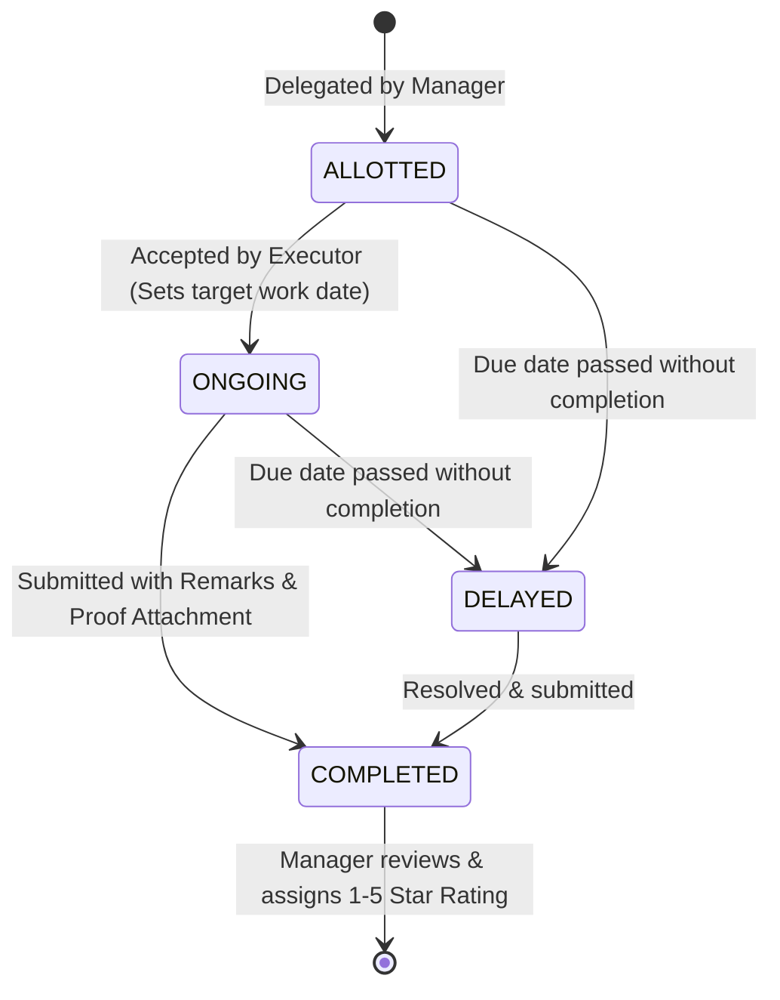
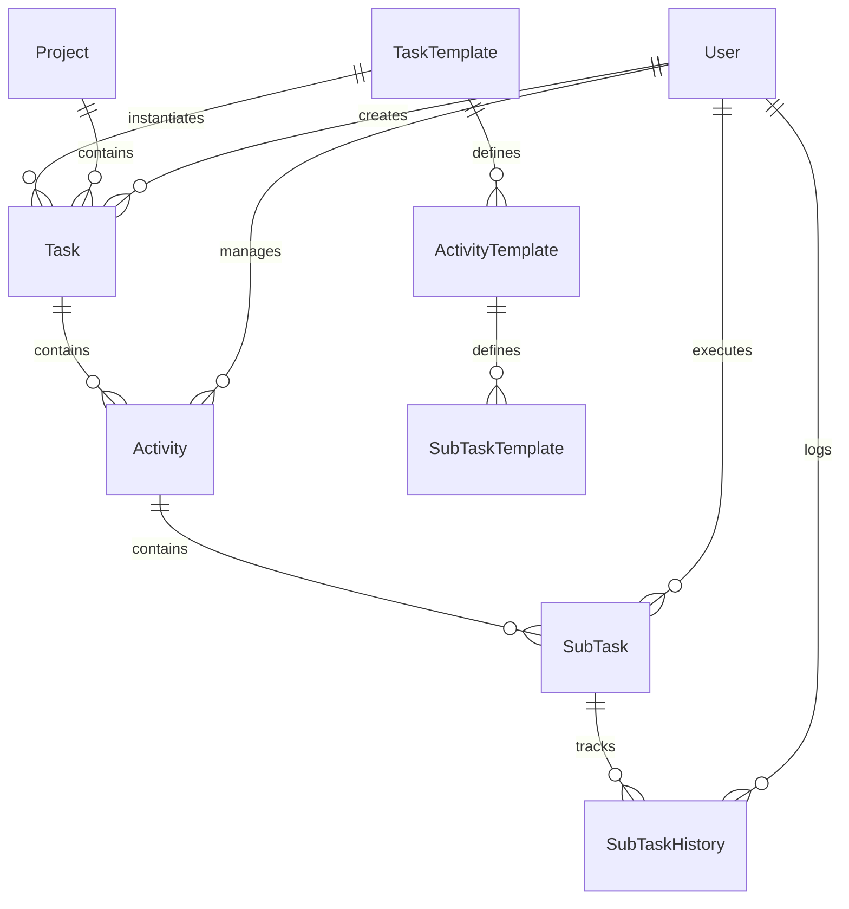

# Multi Mantech International Pvt. Ltd. (MMIPL)
## Enterprise Task Management & Workflow Delegation System (TaskFlow)

---

## 1. Executive Summary & Business Motivation

### Why Was This System Created?
Multi Mantech International Pvt. Ltd. (MMIPL) manages large-scale, multidisciplinary engineering, surveying, infrastructure, and architectural consultancy projects. Previously, task assignment and progress tracking relied on fragmented channels—spreadsheets, manual checklists, emails, and WhatsApp messages. This created critical operational bottlenecks:

1. **Lack of Operational Accountability**: Unclear ownership between project coordinators (Managers) and on-ground engineers/draftsmen (Executors).
2. **Missed Project Deadlines**: Without automated Day-0 milestone tracking, schedule slippages were identified only after delivery deadlines had already passed.
3. **Non-Standardized Deliverables**: Repeated projects (e.g., Gas Distribution, Topographical Survey, Highway CAD) were planned from scratch each time rather than utilizing proven standard blueprints.
4. **No Formal Verification of Work**: Tasks were marked "done" verbally without mandatory proof-of-work deliverables (drawings, PDF reports, field data).
5. **No Audit Trail**: When delays occurred, management had no chronological record to audit why or when a task stalled or who reallocated it.

### Business Objective
**TaskFlow** was engineered as MMIPL’s centralized, role-based workflow orchestration platform. It converts standard operational blueprints into actionable, time-bounded task trees, establishes clear ownership across three distinct tiers of management, enforces mandatory proof-of-work attachments, and provides executives with real-time visibility into project health.

---

## 2. Core Business Logic & Architecture

### A. The Project "Day-0" Timeline Model
Every infrastructure contract has an official start date referred to as **Day 0**. 
- In TaskFlow, all subsequent activities and sub-tasks are scheduled relative to Day 0.
- When a template specifies that an activity takes 5 days and its subtask takes 2 days, the system automatically computes exact calendar due dates:
  $$\text{Due Date} = \text{Day 0} + \sum \text{Offset Days}$$
- This guarantees consistent, mathematically sound project scheduling across all phases.

### B. Hierarchical Work Breakdown Structure (WBS)
TaskFlow enforces a structured 4-tier hierarchy:
```
Project (e.g., Ahmedabad City Gas Distribution — P001)
 └── Task (High-level milestone derived from a Template)
      └── Activity (Functional work package assigned to a Manager)
           └── Sub-Task (Atomic unit of work assigned to an Executor)
```

### C. Standard Operating Procedure (SOP) Templates
Instead of re-inventing task lists for every new project:
- Supervisors create **Task Templates** representing standard project types.
- Each template defines ordered **Activities** with estimated completion days and prerequisite personnel roles.
- Each activity contains predefined **Sub-Tasks** with default durations, precedence requirements (`NONE`, `FINISH_TO_START`), and mandatory attachment types (`PDF`, `ZIP`, `DWG`, `Any`).
- Delegating a project requires just 4 wizard steps: **Select Project & Day 0 $\to$ Choose Template $\to$ Assign Managers $\to$ Assign Executors**.

### D. Sub-Task Lifecycle & Governance
Each subtask follows a strict state transition machine:

- **Proof-of-Work Verification**: Executors cannot mark a task completed with meaningless single-word comments (e.g., "done", "ok"). The system enforces descriptive remarks and required file uploads via Cloudinary.
- **Manager Performance Rating**: Completed subtasks are evaluated and scored (1 to 5 stars) by the supervising Manager, building long-term workforce performance metrics.
- **Work Reallocation & Withdrawal**: If an executor is unavailable or delayed, managers can reallocate the subtask to another team member or withdraw it with automatic audit notes.

---

## 3. Organizational Roles & Permission Matrix

| Capability | SUPERVISOR (Director / Admin) | MANAGER (Project Lead) | EXECUTOR (Engineer / Draftsman) |
|---|:---:|:---:|:---:|
| **Access Executive Dashboard** (All Projects) | ✅ | ❌ | ❌ |
| **Create & Edit Projects & Day-0 Dates** | ✅ | ❌ | ❌ |
| **Create & Manage Standard Templates** | ✅ | ✅ | ❌ |
| **Delegate Workpackages (4-Step Wizard)** | ✅ | ✅ | ❌ |
| **Reallocate / Withdraw Subtasks** | ✅ | ✅ | ❌ |
| **Rate Completed Work (1–5 Stars)** | ✅ | ✅ | ❌ |
| **Trigger System-wide Overdue Sweeps** | ✅ | ❌ | ❌ |
| **Accept Allotted Tasks & Set Schedule** | ❌ | ❌ | ✅ |
| **Submit Work with Proof & Remarks** | ❌ | ❌ | ✅ |
| **View Audit Trail & Historical Logs** | ✅ | ✅ (Own team) | ❌ |
| **User & Team Management** | ✅ | ❌ | ❌ |

---

## 4. Technology Stack

- **Frontend & Fullstack Framework**: [Next.js 16 (App Router)](https://nextjs.org) with Turbopack bundler.
- **User Interface**: [React 19](https://react.dev), [Tailwind CSS](https://tailwindcss.com), [Lucide React](https://lucide.dev) iconography.
- **Database ORM**: [Prisma ORM 6](https://www.prisma.io) with type-safe client generation.
- **Database Engine**: Hosted PostgreSQL with SSL pooling.
- **Authentication**: [NextAuth.js v4](https://next-auth.js.org) using JWT session strategy and BCrypt password encryption.
- **Cloud Storage**: [Cloudinary API](https://cloudinary.com) for secure hosting and streaming of drawings, reports, and task attachments.
- **Analytics & Visualizations**: [Recharts](https://recharts.org) for team productivity charts and status distributions.

---

## 5. Vercel Deployment & Fixing Common Errors

### Understanding the Vercel `[NO_SECRET]` Crash
If you see the following in your Vercel runtime logs:
```
[next-auth][error][NO_SECRET] Please define a 'secret' in production.
Error [MissingSecretError]: Please define a 'secret' in production.
```
**Why this happens**: NextAuth in production strictly requires an encryption secret to hash JWT session cookies. If this key is missing from the Vercel project environment settings, NextAuth halts the entire application with a 500 server configuration error.

### Required Environment Variables on Vercel
Add the following keys in **Vercel Dashboard $\to$ Project Settings $\to$ Environment Variables**:

| Variable Name | Required Value / Description | Example |
|---|---|---|
| `NEXTAUTH_SECRET` | 32+ character random secret string | `tms-secret-2024-mmipl-prod-987abc` |
| `NEXTAUTH_URL` | Full canonical URL of your Vercel deployment | `https://task-management-mmipl-jaaq.vercel.app` |
| `PRISMA_DATABASE_URL` | PostgreSQL connection string with SSL | `postgres://...:5432/postgres?sslmode=require` |
| `DATABASE_URL` | Fallback PostgreSQL connection string | `postgres://...:5432/postgres?sslmode=require` |
| `CRON_SECRET` | Secret string for automated overdue cron jobs | `cron-secret-2024-xyz` |
| `CLOUDINARY_CLOUD_NAME` | Cloudinary account cloud identifier | `deawzppba` |
| `CLOUDINARY_API_KEY` | Cloudinary API Key | `887842912374735` |
| `CLOUDINARY_API_SECRET` | Cloudinary API Secret Key | *(Your secret key)* |

> [!TIP]
> The codebase includes an automated fallback inside `lib/auth.js` and `proxy.js` so that even if `NEXTAUTH_SECRET` is temporarily omitted in Vercel settings, the system gracefully falls back to an internal key instead of crashing. However, adding `NEXTAUTH_SECRET` to the Vercel dashboard is the recommended production practice.

---

## 6. Directory Structure & Key Files

```
e:/mmipl/task/task-management-system/
├── app/
│   ├── (auth)/               # Login & Registration views
│   ├── api/                  # Serverless REST endpoints
│   │   ├── auth/             # NextAuth route handler ([...nextauth])
│   │   ├── cron/             # Scheduled background jobs (mark-delayed)
│   │   ├── dashboard/        # Role-filtered dashboard statistics
│   │   ├── delegation/       # Work package delegation services
│   │   ├── projects/         # Project CRUD and Day-0 calculations
│   │   ├── subtasks/         # Subtask acceptance, submissions, ratings
│   │   └── templates/        # Standard SOP templates and activities
│   ├── dashboard/
│   │   ├── executor/         # Executor worklist (Allotted, On-hand, Due soon)
│   │   ├── manager/          # Manager tactical board & rating center
│   │   └── supervisor/       # Executive command center & team drilldown
│   ├── delegation/new/       # 4-Step Delegation Wizard
│   ├── history/              # System-wide Audit Trail
│   ├── projects/             # Project Management & Day-0 registry
│   ├── settings/             # Profile, passwords, and user admin
│   ├── templates/            # SOP Template Builder & Editor
│   ├── layout.js             # Global root layout & session provider
│   └── page.js               # Smart role-based root redirector
├── components/
│   ├── dashboard/            # StatCards, charts, and summary widgets
│   ├── layout/               # Sidebar and Navbar with live notifications
│   └── ui/                   # Badges, modals, and reusable controls
├── lib/
│   ├── auth.js               # NextAuth credentials provider configuration
│   ├── prisma.js             # Singleton Prisma Client with connection reuse
│   ├── utils.js              # Date calculations, color tokens, and cn helper
│   └── ai-validator.js       # Fast-path remark validation
├── prisma/
│   ├── schema.prisma         # Data models and relation definitions
│   └── seed.js               # Starter database seeding script
├── proxy.js                  # Next.js 16 Route Protection Proxy (formerly middleware)
├── .env                      # Local environment configuration
└── package.json              # Dependency manifest
```

---

## 7. Database Model Architecture (Prisma)



- **User**: System identities with strict role segregation (`SUPERVISOR`, `MANAGER`, `EXECUTOR`).
- **Project**: Capital projects with unique codes and baseline Day-0 dates.
- **TaskTemplate / ActivityTemplate / SubTaskTemplate**: Reusable SOP definitions.
- **Task / Activity / SubTask**: Live instantiated work packages tracking status (`ALLOTTED`, `ONGOING`, `COMPLETED`, `DELAYED`), ratings, proof-of-work attachment URLs, and submission notes.
- **SubTaskHistory**: Immutable chronological audit log recording every status change, responsible user, and timestamp.

---

## 8. Development & Build Commands

```bash
# 1. Install dependencies
npm install

# 2. Synchronize Prisma Schema with Database
npx prisma db push

# 3. Seed starter accounts (Alice, Bob, Dave)
npm run prisma:seed

# 4. Start local development server
npm run dev

# 5. Compile production build (tested with Turbopack)
npm run build

# 6. Start production server
npm start
```

---

## 9. Recent Fixes & UI/UX Hardening

1. **Eliminated NextAuth Production NO_SECRET Error**:
   - Fortified `lib/auth.js` and `proxy.js` with an automated fallback so that unconfigured Vercel deployments do not throw `MissingSecretError`.
2. **Fixed React Hydration Mismatch & Non-Functional Buttons in Projects Table**:
   - Replaced invalid nested `<tbody>` structures in `app/projects/page.js` with React `<Fragment>`, restoring edit/delete button responsiveness.
3. **Protected Dashboards Against 401 & Undefined Data Crashes**:
   - Added robust try/catch blocks, automatic `/login` redirects on expired sessions, and safe optional chaining across Executor, Manager, and Supervisor dashboards.
4. **Resolved Next.js 16 Middleware Convention Warning**:
   - Updated root middleware to Next.js 16's official `proxy.js` convention.
5. **Fixed Template Mapping Crashes**:
   - Guaranteed array fallbacks (`(t.activities || [])` and `(a.subTasks || [])`) to prevent blank-screen errors when viewing or editing templates with empty activity lists.
6. **Removed Redundant & Corrupted Files**:
   - Deleted broken `[...nextauth` folder with unmatched brackets.
   - Removed temporary `CLAUDE.md` and redundant `proxy.js` duplicates.
